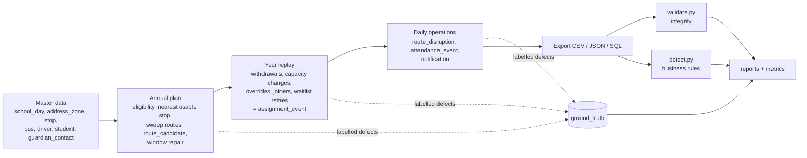
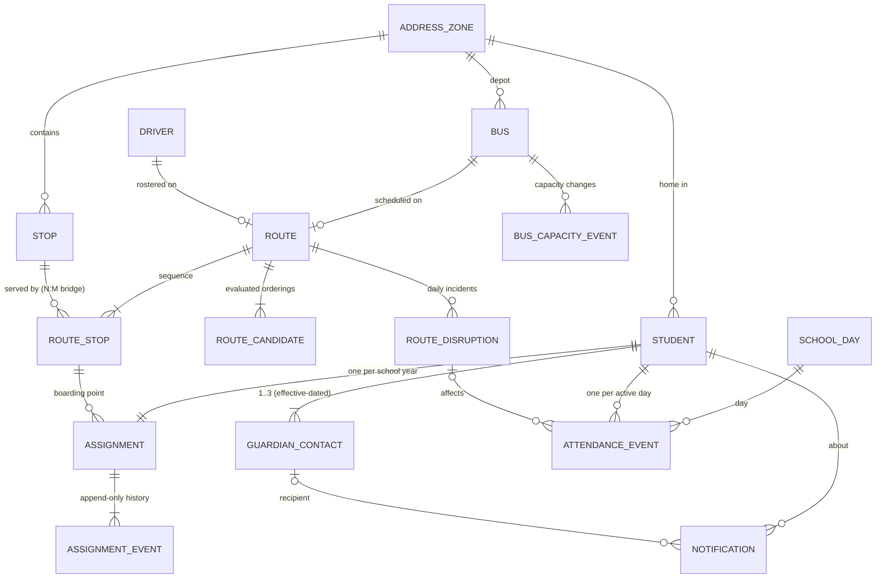
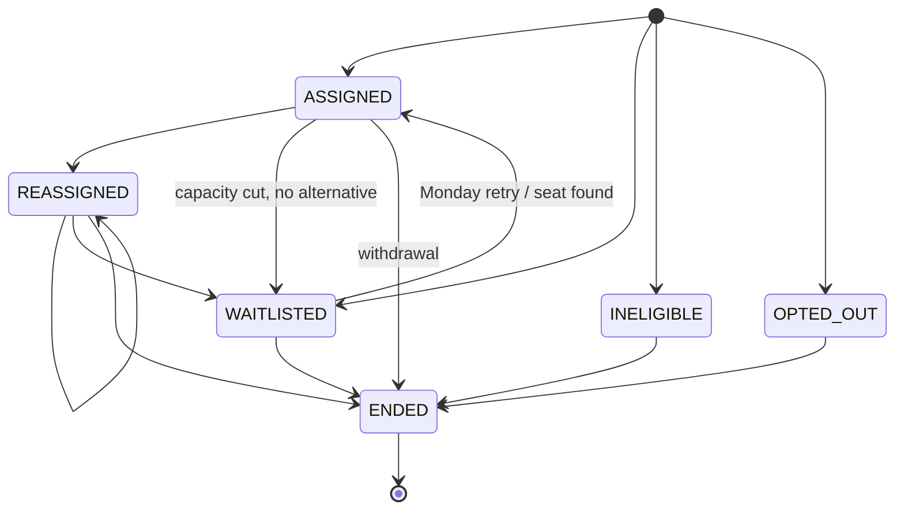

# Design notes

## 1. Workflow

Every arrow consumes *persisted* records: operations are driven by `assignment_event`
history (via `rules.build_segments`), and validation/detection read the exported CSVs
back from disk, never the generator's in-memory state.

## 2. Entity relationships

Cardinalities, optionality and every field's type/unit/enum/validation rule are in
[`data_dictionary.md`](data_dictionary.md) (generated from `transport/schema.py`).

* **N:M** Route-Stop uses the `route_stop` bridge. A stop can be served by a regular
  and an accessible route, or split across two regular routes when its demand exceeds
  one bus.
* **Effective dating**: `stop.effective_from/to`, `guardian_contact.valid_from/to` (+
  `superseded_by` chain), `route.effective_from/to`, `route_stop.effective_from/to`,
  `bus_capacity_event.effective_from/to`, `student.enrolled_on/withdrawn_on`.
* **History is never overwritten**: assignment changes are new `assignment_event` rows;
  the `assignment` header keeps the initial decision and only its *derived*
  `current_status` reflects the latest event. Replaced guardian contacts keep their
  row. Capacity changes are events, not edits to `bus`.

## 3. Lifecycles

Assignment (`rules.ALLOWED_TRANSITIONS`):

Other lifecycles: student `active -> withdrawn`; stop `pending -> approved | rejected`;
guardian contact `active -> bounced | inactive` (or `inactive` + `superseded_by`);
route `active` for the year; disruption `delayed_service | replacement_bus | spare_driver | cancelled`.

## 4. Decision rules (engine)

| Step | Rule | Exception path (persisted reason) |
|---|---|---|
| Eligibility | home >= 1.6 km from school, guardian opted in, address verified | `INELIGIBLE_WALK_ZONE`, `OPTED_OUT_GUARDIAN`, `WAITLIST_ADDRESS_PENDING` |
| Stop choice | nearest **approved** stop within `min(zone, grade, mobility)` walk cap; accessible stop if a mobility aid is used | `WAITLIST_NO_STOP_IN_RANGE`, `WAITLIST_NO_ACCESSIBLE_STOP` |
| Route build | angle sweep per network; load <= 90 % of seats; wheelchairs <= positions; first pickup -> school <= 60 min | buses exhausted -> `WAITLIST_NO_CAPACITY` |
| Route order | best feasible of radial-inbound, nearest-neighbour, 2-opt (all kept in `route_candidate`) | infeasible candidates keep `rejection_reason` |
| Pickup window | shift arrival 07:35-07:50 to satisfy most windows, then move violators to a compatible stop with a free seat | `ASSIGNED_ALT_STOP_FOR_WINDOW`, else `ASSIGNED_WINDOW_EXCEPTION` + guardian notice |
| Capacity change | overflow (latest-assigned first) moved to compatible route with seat and in-window pickup | `CAPACITY_REDUCED_REASSIGN` or `WAITLIST_CAPACITY_REDUCED` |
| Joiners / retries | same stop + seat search on enrollment day; capacity-waitlist retried every Monday | `MIDYEAR_ASSIGNED`, `ASSIGNED_FROM_WAITLIST` |
| Attendance | reported absence / cancellation / >15 min late = missed / unreported absence = no-show / >5 min late = boarded_late | notices: `NO_SHOW`, `MISSED_PICKUP`, `SERVICE_CANCELLED`, `ROUTE_DELAY` (>=10 min) |
| Notification | highest-priority contact that is active, consented, effective, well-formed for its channel | `suppressed` / `NO_VALID_CONTACT` |

## 5. Actors

| Brief actor | Role in this workflow | Where it appears |
|---|---|---|
| Learner | the transported student | `student`, `attendance_event` |
| Instructor | consumer of daily attendance / late-arrival information | `attendance_event` (status, delay) |
| Academic administrator | approves stops, withdrawals, manual overrides | `assignment_event.actor_role`, `stop.approval_status` |
| Support staff | dispatch: capacity changes, spare buses/drivers, driver app | `bus_capacity_event.recorded_by`, `route_disruption`, `attendance_event.recorded_by` |
| Platform administrator | runs the generator, validation and reports | CLI, `manifest.json`, `reports/` |
| Guardian (contact) | receives notices | `guardian_contact`, `notification` |

## 6. Edge cases (labelled in `ground_truth/`)

| issue_type | How it is injected | Detector rule | Expected decision |
|---|---|---|---|
| capacity_exceeded | capacity cut recorded on a bus but the engine skips rebalancing | daily load > effective seats (or wheelchairs > positions) | reassign_or_waitlist_overflow |
| incompatible_route | admin override moves a wheelchair/walker user onto a regular bus | accessible-need student active on non-accessible route | revert_to_accessible_route |
| impossible_travel_time | one long leg timed at 250-600 km/h | implied speed > 70 km/h or non-positive leg time | reject_route_plan |
| notification_invalid_contact | notice re-pointed to bounced / inactive / expired / malformed / other family's contact | recipient fails `rules.contact_problems` | block_send_and_use_valid_contact |
| unapproved_address_exposed | pending home-address stop placed on a route; or address text in a message | route uses unapproved stop; message matches address pattern | remove_stop_or_redact_message |

Only the defective records change; derived values are recomputed so integrity
validation still passes (a corrupted record would hide the business defect behind a
parse error). Ground truth rows carry `entity_table` + `entity_id`, `related_ids`,
`first_date`, `expected_decision` and `rule_violated`.

## 7. Reproducibility

* One seed, separate SHA-256-derived random streams per stage (`ids.stage_rng`), so a
  change in one stage never shifts another stage's randomness and `PYTHONHASHSEED`
  is irrelevant.
* No wall-clock values in data; iteration is always over sorted keys.
* gzip output uses `mtime=0`.
* `python -m transport repro` regenerates twice with the same seed (identical
  checksums expected) and once with `seed+1` (changes expected).

## 8. Known simplifications

* AM session only (PM is symmetric and would double volumes without new rules).
* Straight-line distance x 1.3 circuity with ring speeds instead of a road network.
* One school campus; routes are fixed for the year (stops are not added mid-year).
* Replacement-bus days are not re-checked for seat capacity by the detector (the
  dispatcher only picks spares with enough seats).
